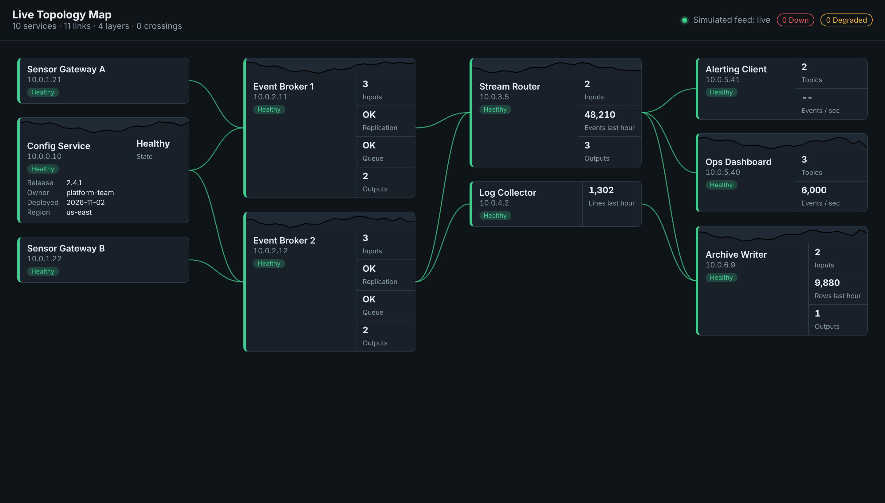

# Live Topology Map

A React + TypeScript demo that turns a list of services into a live, auto-arranged map:
cards for each service, curved leader lines showing who feeds whom, sparklines for load,
and health changes streamed in over a WebSocket (or a built-in simulator).

**[Live demo](https://wedwu.github.io/live-topology-map/)** (runs on the built-in simulator, no backend needed)



## Why this exists

Operations dashboards often list services in a table, which hides the one thing you need during an
incident: what is upstream of the thing that just went red. This demo lays the system out as a
dependency graph automatically, so the picture stays correct as services are added or rewired.

All service names, hosts and numbers in `src/data/sample.ts` are invented.

## Run it

```bash
npm install
npm run dev        # simulated feed, no backend needed
npm test           # layout and reducer tests
npm run build
```

To point it at a real backend, set `VITE_FEED_URL=wss://your-host/feed`. The client expects JSON
messages shaped like `FeedMessage` in `src/lib/types.ts` (`snapshot`, `patch`, `sample`) and
reconnects with exponential backoff.

## How the layout works (`src/lib/layout.ts`)

Each service lists the services it receives from (`upstream`). From that:

1. **Edges.** Build directed edges upstream -> service. References to unknown ids are reported
   instead of crashing the map.
2. **Columns (layers).** Run Kahn's topological sort and take the longest path from any source,
   so every service sits one column right of its deepest upstream. Sources land in column 0.
3. **Cycles.** Anything Kahn's algorithm cannot order is on a cycle. Those services go into one
   extra column at the end and the UI shows a warning, so bad data is visible rather than hidden.
4. **Row order.** Alternating barycenter sweeps move each card toward the average row of its
   neighbours in the next column (left to right using upstreams, right to left using downstreams).
5. **Transpose pass.** Swap neighbouring cards in a column whenever that lowers the crossing count.
   This cleans up the last crossings barycenter leaves behind.

The layout only recomputes when the graph shape changes, not on every metric update, so cards
do not jump around while data streams in.

## How the leader lines work (`src/components/LeaderLines.tsx`)

The cards are normal flexbox columns. An SVG layer underneath measures each card with
`getBoundingClientRect`, then draws a cubic Bezier from the right edge of the upstream card to the
left edge of the downstream card. A `ResizeObserver` re-measures when cards or the window change size.
Lines take the colour of the worst health at either end, and selecting a card dims unrelated lines.

## Cards (`src/components/NodeCard.tsx`)

- Identity column (name, host, health) on the left, metrics on the right.
- Metrics are ordered inputs first, outputs last, everything else in between.
- A sparkline of recent load (values 0 to 1) appears only when there is data.
- Control services also show key/value details (release, owner and so on).
- Cards are buttons: keyboard focusable, with an accessible name that includes health.

## Project layout

```
src/
  lib/types.ts        data model and feed message types
  lib/layout.ts       layered graph layout + crossing counter
  lib/feed.ts         WebSocket client, simulator, and the update reducer
  components/         NodeCard, Sparkline, LeaderLines, DetailPanel
  data/sample.ts      invented sample topology
tests/layout.test.ts
```

## Ideas for next steps

- Drag to pan and zoom for large graphs
- Group services by zone or team
- Persist which card is selected in the URL

## How it was built

This is a clean-room public version of a dependency-map component I designed and built professionally (that code is private). I built this version with Claude as a pair programmer: I set the requirements, the layout approach and the architecture, and reviewed every change.

## License

MIT
